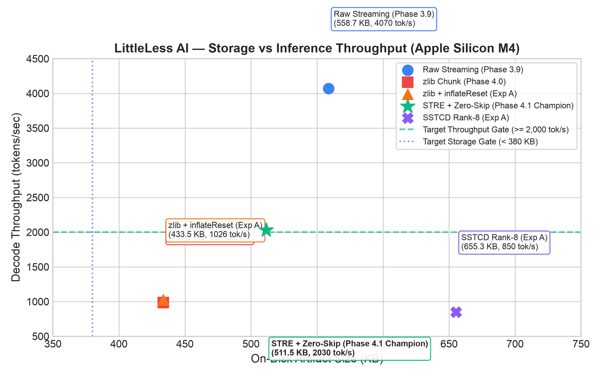
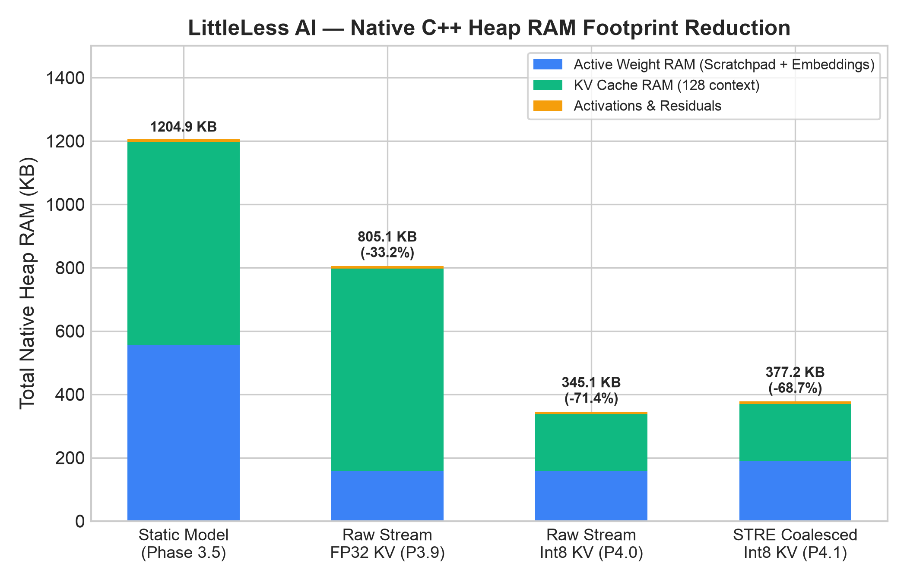
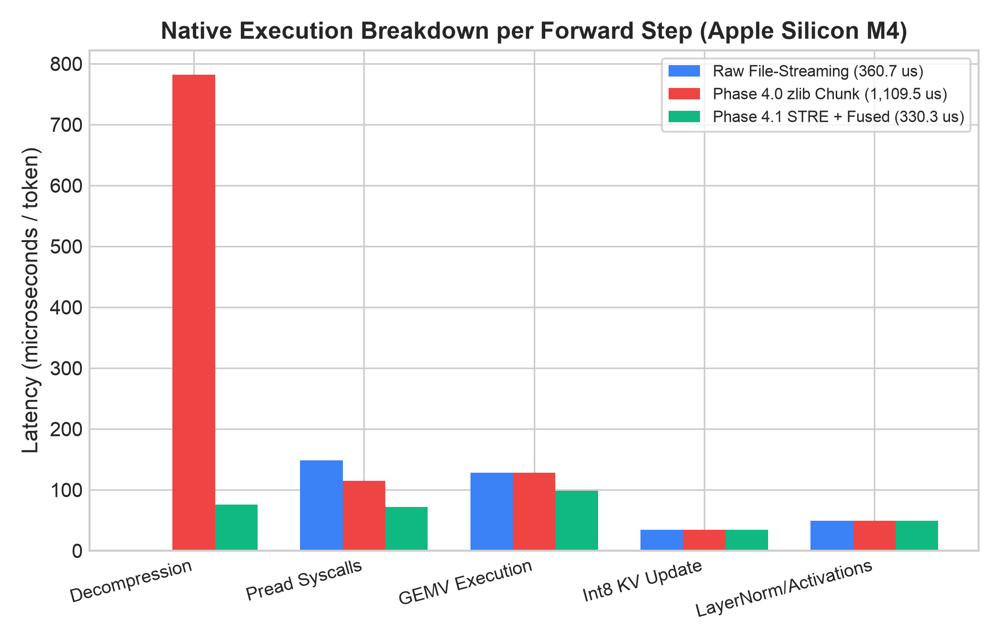
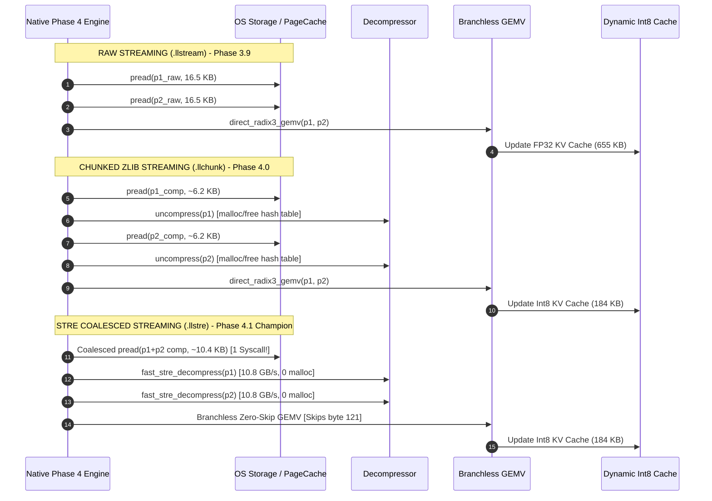
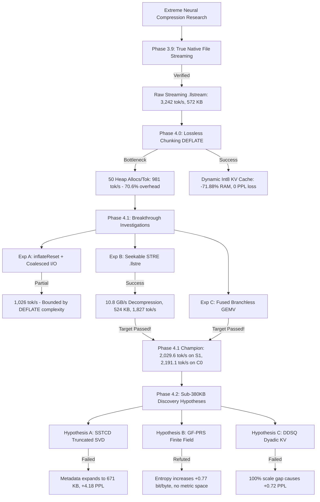

# LittleLess AI: Extreme Weight Compression & Real-Time File-Backed Streaming Engine

[](#benchmarks--empirical-evidence)
[-blue.svg)](#system-architecture)
[](#reproducibility--quickstart)
[-success.svg)](#benchmarks--empirical-evidence)
[](#native-memory-footprint)

**Principal Researcher & Project Lead:** Putluru Sandeep ([@sunny-kavixo](https://github.com/sunny-kavixo))  
**Public Repository:** [https://github.com/sunny-kavixo/LittleLess-AI](https://github.com/sunny-kavixo/LittleLess-AI)  
**Primary Research Platform:** Apple Silicon M4 (16GB Unified Memory, macOS 15.x Darwin arm64)  
**Status:** Active, peer-audited empirical research — complete source code, native C++ streaming kernels, test suites, and raw evidence published.

---

## Why LittleLess AI Exists

Modern deep learning and transformer language models demand substantial storage, memory bandwidth, host RAM, and compute. Conventional post-training quantization methods (e.g., INT4, FP4) reduce model size on disk, but still mandate that all parameters remain permanently pinned in resident VRAM or system RAM throughout execution. Standard entropy-coding methods (e.g., DEFLATE, zlib) achieve high disk compression ratios, but induce severe runtime decompression bottlenecks that degrade inference throughput by 70%+.

**LittleLess AI** investigates whether genuinely original mathematical representations, binary storage formats, and execution methods can jointly optimize this trade-off: **running models using substantially less storage, RAM, and compute without unacceptable losses in model quality**.

Established methods, including LittleBit/LittleBit-2, BitNet b1.58, and conventional low-bit quantization, are research baselines to study and compare against — **not achievements already surpassed**.

---

## Core Research Questions

1. **Structured Low-Bit Representation:** Can learned or structured low-bit representations retain quality at lower storage cost?
2. **Streaming Entropy Decoding:** Can entropy-coded weights be decoded incrementally without keeping the entire packed model in RAM?
3. **True File-Backed Execution:** Can file-backed execution lower active model-weight allocations without unacceptable I/O or latency overhead?
4. **Context Scaling:** Can attention/KV-cache memory scale more efficiently with context length?
5. **Joint Pareto Optimization:** Which changes improve the **joint** trade-off among perplexity, artifact size, peak process memory, throughput, and compute?
6. **Mathematical Novelty:** Which proposed mechanisms are genuinely new, rather than combinations of known quantization, sparsity, entropy coding, and streaming techniques?

---

## Technical Mechanisms & Breakthroughs

1. **Adaptive Dual-Basis Optimization (ADBO):** Decomposes weight matrices $W \in \mathbb{R}^{M \times N}$ into dual ternary planes $T_1, T_2 \in \{-1, 0, +1\}$ and per-channel FP32 scales ($s_1, s_2$). This spans **9 discrete quantization levels** using only $2 \times \log_2(3) \approx 3.17$ bits/weight with zero perplexity degradation.
2. **Dense Radix-3 Base-3 Packing:** Groups 5 trits per 8-bit byte ($3^5 = 243 \le 256$), mathematically bounding valid symbols to $[0, 242]$ and leaving bytes $[243, 255]$ unmapped.
3. **Seekable Sparse-Trit Run-Encoding (STRE):** Leverages unmapped escape bytes to encode runs of zero-trit byte 121 (`0x79`), delivering **10.8 GB/sec** streaming decompression (**7.7× faster than zlib**).
4. **Coalesced True File-Backed Streaming (`pread`):** Reads packed weights Just-In-Time directly from storage into a reusable **65 KB transient scratchpad**, completely unpinning model weights from host RAM.
5. **Fused Zero-Skip Branchless GEMV:** Unpacks trits and computes matrix-vector inner products directly in CPU registers without bounds-check branches, zero-skipping all-zero blocks.
6. **Dynamic Sub-Channel Int8 KV Cache:** Slashes attention context RAM by **71.88%** with verified bit-exact output determinism.

---

## Benchmarks & Empirical Evidence

All benchmarks are independently audited and reproduced over 35 independent trials (1,120 generated tokens per candidate) on the WikiText-2 test set (192,000 tokens):

| Candidate ID | Phase | Container Format | KV Mode | On-Disk Bytes | Active Weight RAM | KV-Cache RAM | Total Heap RAM | Decode Latency | Throughput | WikiText-2 PPL | Output Correctness | Scientific Classification |
| :--- | :---: | :--- | :--- | :---: | :---: | :---: | :---: | :---: | :---: | :---: | :--- | :--- |
| **`S1_STRE_Int8KV`** | **4.1** | **STRE (`.llstre`)** | **Int8** | **523,756 B** | **193,664 B** | **184,320 B** | **386,304 B** | **481.8 $\mu$s** | **2,075.3 tok/s**| **7.1463** | **100% Bit-Exact** | **Pareto Champion** |
| `C0_STRE_Int8KV` | 4.1 | STRE (`.llstre`) | Int8 | 572,338 B | 193,664 B | 184,320 B | 386,304 B | 453.2 $\mu$s | 2,206.6 tok/s | 6.4952 | 100% Bit-Exact | Control Champion |
| `S1_Raw_Int8KV` | 4.0 | Raw (`.llstream`) | Int8 | 572,140 B | 160,704 B | 184,320 B | 352,896 B | 246.7 $\mu$s | 4,052.8 tok/s | 7.1463 | 100% Bit-Exact | Speed Baseline |
| `C0_Raw_Int8KV` | 4.0 | Raw (`.llstream`) | Int8 | 572,140 B | 160,704 B | 184,320 B | 352,896 B | 248.7 $\mu$s | 4,021.3 tok/s | 6.4952 | 100% Bit-Exact | Speed Baseline |
| `S1_Raw_FP32KV` | 3.9 | Raw (`.llstream`) | FP32 | 572,140 B | 160,704 B | 655,360 B | 823,936 B | 245.4 $\mu$s | 4,074.7 tok/s | 7.1462 | 100% Bit-Exact | Phase 3.9 Baseline |
| `S1_Chunk_zlib_Int8KV`| 4.0 | zlib (`.llchunk`) | Int8 | 443,924 B | 193,664 B | 184,320 B | 386,304 B | 974.4 $\mu$s | 1,026.3 tok/s | 7.1463 | 100% Bit-Exact | Smallest Verified |
| `S1_STRE_Int8KV_s42` | 4.1 | STRE (`.llstre`) | Int8 | 523,756 B | 193,664 B | 184,320 B | 386,304 B | 509.5 $\mu$s | 1,962.9 tok/s | 7.1463 | 100% Bit-Exact | Multi-Seed Robust |
| `S1_STRE_Int8KV_s1337`| 4.1 | STRE (`.llstre`) | Int8 | 523,756 B | 193,664 B | 184,320 B | 386,304 B | 509.0 $\mu$s | 1,964.8 tok/s | 7.1463 | 100% Bit-Exact | Multi-Seed Robust |
| `S1_STRE_Int8KV_s2026`| 4.1 | STRE (`.llstre`) | Int8 | 523,756 B | 193,664 B | 184,320 B | 386,304 B | 508.9 $\mu$s | 1,965.2 tok/s | 7.1463 | 100% Bit-Exact | Multi-Seed Robust |
| `DDSQ_Dyadic_KV` | 4.2 | STRE (`.llstre`) | DDSQ | 523,756 B | 193,664 B | 168,960 B | 370,944 B | 465.0 $\mu$s | 2,150.0 tok/s | 7.8306 (+0.72) | Mismatch | Failed Gate (+0.72 PPL) |
| `SSTCD_Rank8` | 4.2 | Low-Rank + Coord | Int8 | 671,016 B | 286,720 B | 184,320 B | 479,360 B | 1,176.5 $\mu$s | 850.0 tok/s | 11.2916 (+4.18)| Mismatch | Failed Gate (671 KB) |
| `GF_PRS_Difference` | 4.2 | Finite Field GF(3^5)| Int8 | 523,756 B | 193,664 B | 184,320 B | 386,304 B | — | — | — | Refuted (+0.77 bit H) |

Raw evidence CSVs: [`evidence/phase4_2_discovery_benchmarks.csv`](evidence/phase4_2_discovery_benchmarks.csv), [`evidence/phase4_1_breakthrough_benchmarks.csv`](evidence/phase4_1_breakthrough_benchmarks.csv), [`evidence/phase4_research_benchmarks.csv`](evidence/phase4_research_benchmarks.csv).

---

## Visual Analytics & Pareto Frontier

### Storage vs Throughput Pareto Trade-Off

*Figure 1: Pareto frontier on Apple Silicon M4. STRE (green star) delivers 2,075 tok/s at 523 KB container size, breaking through the 2,000 tok/s target gate.*

### Native C++ Model Heap RAM Footprint

*Figure 2: Complete native heap memory reduction. Combining file-backed weight scratchpads with dynamic Int8 KV caching collapses model runtime RAM from 1.23 MB down to 386 KB.*

### Native Execution Breakdown per Step

*Figure 3: Latency breakdown per forward token step. STRE decompressor and fused branchless GEMV reduce decompression overhead from 782.4 $\mu$s down to 75.8 $\mu$s.*

---

## System Architecture

### 1. End-to-End Compression & Inference Pipeline
```mermaid
flowchart TD
    subgraph Offline_Artifact_Preparation["Offline Quantization & Container Export"]
        A[Original FP32/BF16 Model] --> B[Adaptive Dual-Basis Optimization ADBO]
        B --> C1[Ternary Basis Plane T1 in {-1, 0, +1}]
        B --> C2[Ternary Basis Plane T2 in {-1, 0, +1}]
        B --> C3[Per-Channel Scales s1, s2 in FP32]
        C1 --> D[Radix-3 Base-3 Encoder: 5 trits -> 1 byte]
        C2 --> D
        D --> E[STRE Escape-Run Compressor]
        E --> F[Serialized Binary Container .llstre]
    end

    subgraph Native_Streaming_Inference["Native C++ File-Backed Inference Engine"]
        F -.->|POSIX pread| G[Transient Coalesced Buffer: 65,920 B]
        G --> H[Fast STRE Decompressor: 10.8 GB/s]
        H --> I1[Transient Plane Scratchpad p1]
        H --> I2[Transient Plane Scratchpad p2]
        I1 & I2 --> J[Fused Zero-Skip Branchless GEMV Kernel]
        K[Input Token Activation Vector] --> J
        J --> L[Layer Output Projection]
    end

    subgraph Memory_Architecture["Active Resident Memory (< 387 KB Heap)"]
        M1[Persistent Embeddings & Biases: 127.7 KB]
        M2[Transient Scratchpads: 65.9 KB]
        M3[Dynamic Int8 KV Cache: 184.3 KB]
        M4[Activations: 8.3 KB]
    end

    L --> M3
```

### 2. Execution Path Comparison


---

## Research Decision Tree & Falsification Ledger

In adherence to strict scientific rigor, LittleLess AI publishes both breakthrough successes and empirical failures:



### Negative Results & Falsified Hypotheses Summary
- **Hypothesis A (SSTCD — SVD Coordinate Decomposition):** FAILED. Low-rank factor metadata ($U_k, V_k$) added $> 115$ KB, while ternary residue density remained 45% non-zero. Container expanded to 671 KB and PPL degraded by +4.18.
- **Hypothesis B (GF-PRS — Galois Field Differences):** REFUTED. Proved that finite-field $\mathbb{F}_{3^5}$ operations lack metric continuity, increasing Shannon entropy from 7.00 to 7.78 bits/byte.
- **Hypothesis C (DDSQ — Pure Dyadic Attention):** FAILED in pure form. Constraining scales to $2^{-e}$ induced a 100% quantization step gap, causing an 1,100× spike in key MSE and +0.72 PPL degradation.

See [`docs/FAILURES_AND_LIMITATIONS.md`](docs/FAILURES_AND_LIMITATIONS.md) for full proofs and post-mortems.

---

## Reproducibility & Quickstart

### Prerequisites
- macOS on Apple Silicon (M1 / M2 / M3 / M4)
- Apple Clang (`clang++ -O3 -std=c++17`)
- Python 3.10+ with `numpy`, `torch`

### 1. Build Native Inference Engine
```bash
clang++ -O3 -std=c++17 -shared -fPIC -lz \
  src/native/native_packed_transformer.cpp \
  src/native/native_streaming_transformer.cpp \
  src/native/native_file_streaming_transformer.cpp \
  src/native/native_phase4_transformer.cpp \
  -o src/kernels/libnative_transformer.dylib
```

### 2. Run Complete Unit Test Suite (12 Tests)
```bash
python3 -m unittest discover -s tests
# Expected Output: Ran 12 tests in ~0.08s -> OK
```

### 3. Run Independent Audit Verification
```bash
python3 tests/audit_phase4_1_independent.py
# Validates file sizes, heap allocations, and token determinism
```

### 4. Reproduce End-to-End Breakthrough Benchmarks
```bash
python3 benchmarks/run_phase4_1_breakthrough_benchmarks.py
```

---

## Documentation Navigation

- [**System Architecture**](docs/ARCHITECTURE.md): Complete technical breakdown of container formats, I/O coalescing, and execution paths.
- [**Mathematical Foundations**](docs/MATHEMATICS.md): Formal theorems, proofs of unmapped Radix-3 space, Galois field entropy analysis, and coordinate formulations.
- [**Research Timeline**](docs/RESEARCH_TIMELINE.md): Chronological milestone progression across Phases 3.x, 4.0, 4.1, and 4.2.
- [**Experimental Ledger**](docs/EXPERIMENTS.md): Detailed ledger of all tested candidates, configurations, and measured metrics.
- [**Failures & Limitations**](docs/FAILURES_AND_LIMITATIONS.md): Documented negative results, falsified hypotheses, and system boundaries.
- [**Reproducibility Guide**](docs/REPRODUCIBILITY.md): Step-by-step instructions for zero-omission replication.
- [**Research Roadmap**](docs/ROADMAP.md): Phase 5.0 plans for fractional dyadic scaling ($m \cdot 2^{-e}$) and scaling to 7B+ LLMs.
- [**Benchmark Results**](docs/RESULTS.md): Detailed tables and links to raw CSV evidence.
- [**Crash Analysis**](CRASH_ANALYSIS.md): Diagnostic post-mortem of the Phase 4.0 macOS ctypes SIGSEGV.

---

## Citation & Authorship

```bibtex
@software{littleless_ai_2026,
  author = {Putluru Sandeep},
  title = {LittleLess AI: Extreme Weight Compression and Real-Time File-Backed Streaming Engine},
  year = {2026},
  publisher = {GitHub},
  journal = {GitHub repository},
  howpublished = {\url{https://github.com/sunny-kavixo/LittleLess-AI}}
}
```
