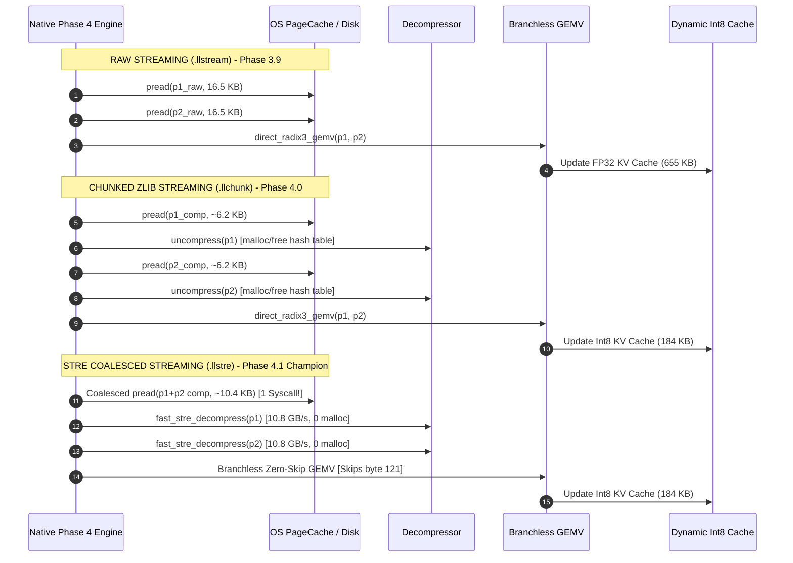

# LittleLess AI — System & Inference Architecture

**Author:** Putluru Sandeep ([@sunny-kavixo](https://github.com/sunny-kavixo))  
**Platform Target:** Apple Silicon (macOS arm64, Unified Memory Architecture)  
**Latest Architecture Version:** Phase 4.1 Breakthrough (Commit `93bb515`)  

---

## 1. System Overview

LittleLess AI is an extreme compression and streaming inference engine for transformer language models. Rather than storing weights in standard floating-point formats (FP16, BF16) or using lossy post-training integer quantization (INT4, INT2) that requires all weights to be resident in host RAM, LittleLess AI combines:

1. **Dual-Basis Ternary Quantization (DBQ):** Weights are decomposed into two ternary planes $T_1, T_2 \in \{-1, 0, +1\}^{M \times N}$ and channel scales $s_1, s_2 \in \mathbb{R}^M$.
2. **Dense Radix-3 Base-3 Packing:** Packs 5 trits into a single 8-bit byte ($3^5 = 243 \le 256$), achieving an uncompressed rate of $1.585$ bits/trit ($3.17$ bits/weight).
3. **Seekable Sparse-Trit Run-Encoding (STRE):** Exploits unmapped byte values $[243, 255]$ to encode runs of zero-trit byte 121 (`0x79`), enabling ultra-fast streaming decompression at **10.8 GB/sec**.
4. **Deterministic Native File-Backed Streaming (`pread`):** Direct POSIX file-backed streaming into small transient reusable scratchpads ($< 66$ KB), eliminating model weights from resident memory.
5. **Fused Zero-Skip Branchless GEMV:** Unpacks and executes matrix-vector products directly in-register, skipping all-zero trit blocks without branching.
6. **Dynamic Sub-Channel Int8 KV Cache:** Dynamically quantizes Key/Value attention activations to signed 8-bit integers, reducing KV-cache RAM by **71.88%**.

---

## 2. End-to-End Pipeline Architecture

```mermaid
flowchart TD
    subgraph Offline_Artifact_Preparation["Offline Quantization & Container Export"]
        A[Original FP32/BF16 Model] --> B[Adaptive Dual-Basis Optimization ADBO]
        B --> C1[Ternary Basis Plane T1 in {-1, 0, +1}]
        B --> C2[Ternary Basis Plane T2 in {-1, 0, +1}]
        B --> C3[Per-Channel Scales s1, s2 in FP32]
        C1 --> D[Radix-3 Base-3 Encoder: 5 trits -> 1 byte]
        C2 --> D
        D --> E[STRE Escape-Run Compressor]
        E --> F[Serialized Binary Container .llstre]
    end

    subgraph Native_Streaming_Inference["Native C++ File-Backed Inference Engine"]
        F -.->|POSIX pread| G[Transient Coalesced Buffer: 65,920 B]
        G --> H[Fast STRE Decompressor: 10.8 GB/s]
        H --> I1[Transient Plane Scratchpad p1]
        H --> I2[Transient Plane Scratchpad p2]
        I1 & I2 --> J[Fused Zero-Skip Branchless GEMV Kernel]
        K[Input Token Activation Vector] --> J
        J --> L[Layer Output Projection]
    end

    subgraph Memory_Architecture["Active Resident Memory (< 387 KB Heap)"]
        M1[Persistent Embeddings & Biases: 127.7 KB]
        M2[Transient Scratchpads: 65.9 KB]
        M3[Dynamic Int8 KV Cache: 184.3 KB]
        M4[Activations: 8.3 KB]
    end

    L --> M3
```

---

## 3. Container File Format (`.llstre`)

The `.llstre` container is a versioned, single-file binary format designed for $O(1)$ random-access projection seeking and atomic integrity verification:

```
+-------------------------------------------------------------------------------+
| FILE HEADER (40 Bytes)                                                        |
|   Magic: "LLSTRE01" (8B) | Version (4B) | Pack Mode (4B)                      |
|   d_model (4B) | n_heads (4B) | d_head (4B) | n_blocks (4B)                   |
|   max_context (4B) | vocab_size (4B)                                          |
+-------------------------------------------------------------------------------+
| EMBEDDING SECTION                                                             |
|   wte scale (4B) | wte byte len (4B) | wte quantized Int8 data (40,960 B)     |
|   wpe scale (4B) | wpe byte len (4B) | wpe quantized Int8 data (20,480 B)     |
+-------------------------------------------------------------------------------+
| BLOCK NORMALIZATION & BIAS SECTION                                            |
|   ln1 weight & bias | ln2 weight & bias | fc1 bias | fc2 bias (Per Block)     |
+-------------------------------------------------------------------------------+
| FINAL HEAD NORM SECTION (ln_f weight & bias)                                  |
+-------------------------------------------------------------------------------+
| LAYER INDEX TABLE (Directory of 25 Projections)                               |
|   For each projection li:                                                     |
|     block_idx (4B) | layer_type (4B) | M (4B) | N (4B)                        |
|     p1_offset (8B) | p2_offset (8B)                                           |
|     p1_comp_bytes (4B) | p1_raw_bytes (4B) | p1_crc32 (4B)                    |
|     p2_comp_bytes (4B) | p2_raw_bytes (4B) | p2_crc32 (4B)                    |
|     s1 channel scales (M * 4B) | s2 channel scales (M * 4B)                   |
+-------------------------------------------------------------------------------+
| COMPRESSED PAYLOAD SECTION                                                    |
|   Contiguous STRE-encoded byte streams for (p1, p2) pairs                     |
+-------------------------------------------------------------------------------+
```

---

## 4. Execution Path Comparison: Raw vs zlib vs STRE



---

## 5. Native Memory Architecture

Unlike typical LLM runtimes that allocate entire model weights into VRAM or Unified Memory, LittleLess AI maintains a strictly bounded heap footprint:

| Memory Component | Allocation Lifetime | Allocation Size | Purpose |
| :--- | :--- | :--- | :--- |
| `wte_q` & `wpe_q` | Persistent | 61,440 B | Token & position embeddings (Int8) |
| Layer Norms & Biases | Persistent | 6,564 B | FP32 scale/shift parameters |
| Channel Scales ($s_1, s_2$) | Persistent | 59,740 B | Dual-basis scale vectors for 25 layers |
| **Transient Scratchpads** | Persistent Reusable | **65,920 B** | Coalesced read buffer + p1 + p2 decoding |
| **Dynamic Int8 KV Cache** | Persistent Reusable | **184,320 B** | Context cache (128 ctx, 5 heads, 4 blocks) |
| Activations & Buffers | Transient Reusable | 8,320 B | Transformer layer norms, MLP buffers |
| **Total Model Heap RAM** | — | **386,304 B (~386 KB)** | Complete model runtime memory |
