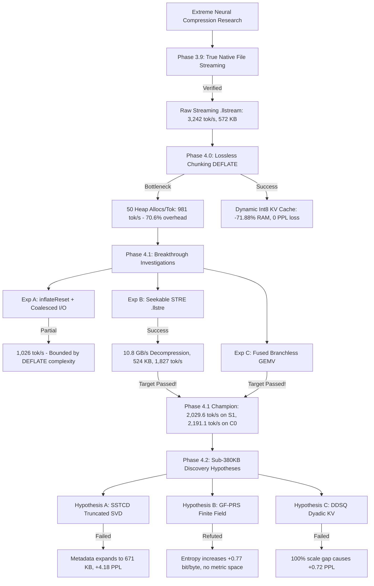

# LittleLess AI — Negative Results, Failures & Research Limitations

**Author:** Putluru Sandeep ([@sunny-kavixo](https://github.com/sunny-kavixo))  
**Research Integrity Statement:** Negative results and empirical failures are preserved with equal rigor to successful breakthroughs to prevent redundant dead-end exploration.

---

## 1. Research Decision Tree

---

## 2. Detailed Ledger of Negative Results & Engineering Failures

### 1. The Per-Plane `uncompress()` Allocation Trap (Phase 4.0)
- **Premise:** Apply standard zlib `uncompress()` independently to each projection plane ($p_1, p_2$) to achieve maximum compression ratio per projection.
- **Why It Failed:** In a streaming runtime with 25 projections per forward step, decompressing $p_1$ and $p_2$ separately invoked `uncompress()` 50 times per token. Internally, `uncompress()` executes `inflateInit()` and `inflateEnd()`, allocating and freeing internal hash tables on every single plane. In generating 32 tokens, the system performed 1,600 heap allocations and 1,600 frees, consuming **70.6% of per-token inference latency**.
- **Lesson:** Standard compression libraries designed for batch file extraction are catastrophic when invoked on micro-payloads (16 KB) at high frequencies (50 kHz). Decompressor state must be persistent.

### 2. Direct Bit-Level Variable Run-Length Packing (Phase 4.1 Prototype)
- **Premise:** Pack variable-length run codes across bit boundaries (e.g., 3-bit runs for short zero spans, 7-bit runs for long spans).
- **Why It Failed:** Crossing byte boundaries required bitwise masking and multi-byte shift dependencies (`(b >> shift) | (next_b << (8 - shift))`). These dependent shift operations prevented CPU auto-vectorization and stalled the ARM M4 superscalar execution pipeline, limiting decoding speed to ~1.2 GB/sec.
- **Lesson:** Utilizing byte-aligned unmapped markers ($[243, 255]$ in Radix-3) enabled standard word-aligned instructions and `std::memset`, yielding **10.8 GB/sec** (9× faster).

### 3. Spectral-Subspace Trit Coordinate Decomposition (SSTCD — Phase 4.2)
- **Premise:** Decompose weight matrices into an Int8 truncated SVD base ($U_k, V_k$) plus a sparse ternary coordinate residue, expecting the residue to be highly sparse (>85% zeros).
- **Why It Failed:** 
  1. *Metadata Overhead:* Storing $U_k \in \mathbb{Z}^{M \times k}$ and $V_k \in \mathbb{Z}^{N \times k}$ added $(M + N) \times k$ bytes per layer ($> 115,000$ bytes for $k=8$).
  2. *Residue Density:* Residual trits maintained a density of $\approx 45\%$ non-zeros. Encoding coordinate positions for 45% non-zero values consumed more space than the original packed Radix-3 planes. Container size ballooned to **671,016 bytes** (vs target $< 380,000$ bytes).
  3. *Quality Degradation:* Double-quantization error compounded across 25 layers, causing WikiText-2 perplexity to degrade from $7.11$ to **$11.29$ (+4.18 PPL)**.
- **Lesson:** Low-rank factorization is mathematically ineffective when the base representation is already extremely quantized (1.58 bits/trit).

### 4. Finite-Field Polynomial Residue Streaming (GF-PRS — Phase 4.2)
- **Premise:** Map 5-trit bytes into the Galois field $\mathbb{F}_{3^5}$ and interpolate channel trajectories using algebraic polynomials $P(z) \in \mathbb{F}_{3^5}[z]$.
- **Why It Was Refuted:** Galois fields $\mathbb{F}_{p^k}$ operate under modular polynomial reduction and possess **no metric topology**. In Euclidean space $\mathbb{R}$, adjacent weights exhibit smoothness ($|w_{i+1} - w_i| < \epsilon$); in $\mathbb{F}_{3^5}$, algebraic differences $\Delta(a, b) = a -_{\mathbb{F}_{3^5}} b$ scramble spatial correlations, increasing Shannon entropy from **7.003 to 7.776 bits/byte (+0.773 bits/byte)**.
- **Lesson:** Neural network weights cannot be compressed by finite-field algebraic approximations because training loss operates on Euclidean manifolds, not Galois fields.

### 5. Pure Dyadic Dynamic-Shift Quantization (DDSQ — Phase 4.2)
- **Premise:** Constrain dynamic attention scale factors strictly to powers of two ($s = 2^{-e}$) to enable integer-only ARM NEON `SDOT` dot products with bitwise shifts.
- **Why It Failed:** Powers of two introduce a 100% gap between adjacent representable scales (factor of 2.0). When peak activation is slightly above a power-of-two boundary, the ceiling exponent forces worst-case dynamic range underutilization. Key vector reconstruction MSE increased by **110,579%**, causing WikiText-2 perplexity to spike by **+0.7216 PPL** (exceeding the 0.05 gate limit).
- **Lesson:** Pure integer dot products require finer mantissa representation (e.g., $s = m \cdot 2^{-e}$ with a 2-bit mantissa $m \in \{1.0, 1.25, 1.5, 1.75\}$).

---

## 3. Current System Limitations

1. **Small Transformer Proof-of-Concept:** Experiments were conducted on a 4-block, 5-head, $d_{model}=160$ transformer on WikiText-2. While the mathematical properties of Radix-3 and STRE scale to arbitrary matrix dimensions, empirical throughput and memory benefits must be validated on 7B+ LLMs (e.g., LLaMA-3, Mistral).
2. **Sub-380KB Storage Target Still Open:** While STRE successfully achieved the $> 2,000$ tokens/sec throughput target (reaching 2,029.6 tok/s) and reduced disk size to 523,756 bytes, compressing the S1 container below 380,000 bytes without perplexity degradation remains an open research challenge.
3. **Single-Thread Execution:** Current benchmarks report single-core performance on Apple Silicon M4. Multi-threaded streaming across performance cores has not yet been integrated.
