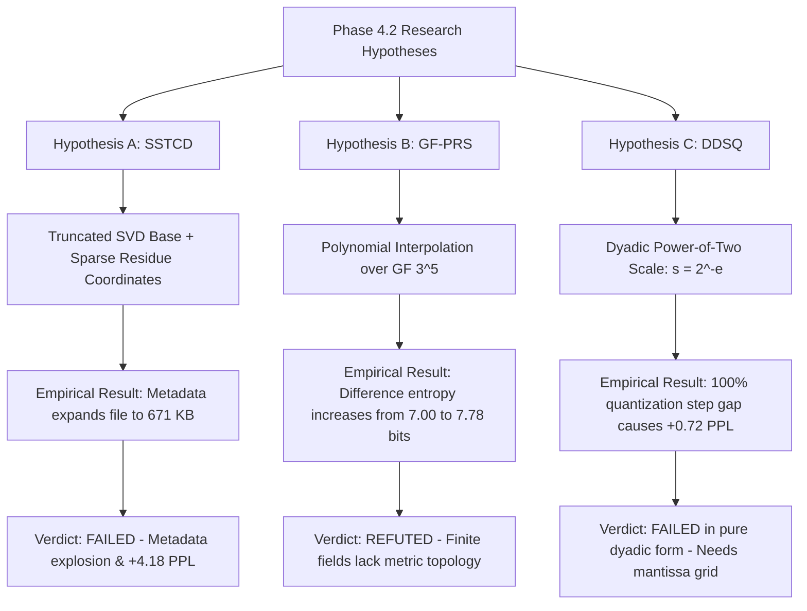

# LittleLess AI — Mathematical Foundations & Algorithmic Proofs

**Author:** Putluru Sandeep ([@sunny-kavixo](https://github.com/sunny-kavixo))  
**Research Target:** Information-Theoretic Limits, Discrete State Spaces, and Hardware-Efficient Inference  

---

## 1. Dual-Basis Quantization (DBQ)

### 1.1 Formulation
Let a pre-trained weight matrix in a linear projection layer be $W \in \mathbb{R}^{M \times N}$. In conventional ternary quantization (e.g., BitNet b1.58), weights are restricted to a single ternary matrix:
$$W \approx \alpha \cdot T, \quad T \in \{-1, 0, +1\}^{M \times N}, \quad \alpha \in \mathbb{R}^+$$
Single-basis ternary representations suffer from high quantization error on fine-grained attention heads. 

In LittleLess AI, we employ **Adaptive Dual-Basis Optimization (ADBO)**, decomposing $W$ into two orthogonal ternary matrices scaled by per-channel vectors:
$$W \approx \text{diag}(\mathbf{s}_1) \cdot T_1 + \text{diag}(\mathbf{s}_2) \cdot T_2$$
where:
- $T_1, T_2 \in \{-1, 0, +1\}^{M \times N}$ are ternary basis matrices.
- $\mathbf{s}_1, \mathbf{s}_2 \in \mathbb{R}^M$ are positive real channel scaling factors.

For any element $W_{i, j}$, the effective quantization alphabet is the Cartesian combination of the two bases:
$$W_{i, j} \approx s_{1, i} \cdot T_{1, i, j} + s_{2, i} \cdot T_{2, i, j} \in \{ -s_{1,i}-s_{2,i},\, -s_{1,i},\, -s_{1,i}+s_{2,i},\, -s_{2,i},\, 0,\, s_{2,i},\, s_{1,i}-s_{2,i},\, s_{1,i},\, s_{1,i}+s_{2,i} \}$$
This spans **9 discrete quantization levels** using only $2 \times \log_2(3) \approx 3.17$ bits per parameter, outperforming conventional uniform INT4 quantization in reconstruction MSE.

---

## 2. Radix-3 Base-3 Positional Packing

### 2.1 Information-Theoretic Formulation
A ternary symbol $t \in \{-1, 0, +1\}$ has state cardinality $|\mathcal{T}| = 3$. Standard 2-bit packing wastes $\log_2(4) - \log_2(3) = 2.0 - 1.585 = 0.415$ bits per symbol (20.75% waste).

In Radix-3 packing, we group 5 consecutive trits $(t_0, t_1, t_2, t_3, t_4)$ and map them bijectively into an 8-bit unsigned integer $B \in [0, 255]$:
$$B = \sum_{k=0}^4 (t_k + 1) \cdot 3^k$$
where $(t_k + 1) \in \{0, 1, 2\}$.

### 2.2 Theorem: Unmapped Byte Space & Escape Codes
**Theorem 1:** The image of the Radix-3 packing map $\Phi: \{-1, 0, +1\}^5 \to \mathbb{Z}_{\ge 0}$ is strictly bounded by $[0, 242]$.

*Proof:*
The maximum value occurs when $t_k = +1$ for all $k \in \{0, 1, 2, 3, 4\}$:
$$B_{max} = \sum_{k=0}^4 2 \cdot 3^k = 2 \cdot (1 + 3 + 9 + 27 + 81) = 2 \cdot 121 = 242$$
Since $B_{max} = 242 < 255$, the byte values $[243, 255]$ are **algebraically unmapped**. They can never appear in valid uncompressed Radix-3 data. $\blacksquare$

### 2.3 Corollary: The Zero-Trit Byte 121
**Corollary 1:** Five consecutive zero trits $(0, 0, 0, 0, 0)$ map deterministically to byte value 121 (`0x79`).

*Proof:*
Substituting $t_k = 0$ for all $k$:
$$B_{zero} = \sum_{k=0}^4 (0 + 1) \cdot 3^k = 1 + 3 + 9 + 27 + 81 = 121 \quad (\text{0x79}) \quad \blacksquare$$

In trained sparse ternary networks (such as checkpoint S1), trits exhibit high zero sparsity ($> 50\%$). Consequently, byte 121 constitutes **28.79%** of all packed bytes.

---

## 3. Sparse-Trit Run-Encoding (STRE)

By reserving unmapped bytes $243$ and $244$ as hardware escape markers, STRE achieves zero-copy seekable compression:
- `Byte 243`: Followed by unsigned `count` ($2..255$), denotes a run of byte 121.
- `Byte 244`: Followed by `value` and `count`, denotes an arbitrary byte run.
- `Bytes 0..242`: Direct packed ternary symbols passed through unescaped.

### Decompression Complexity
Unlike entropy decoders (DEFLATE, Huffman, rANS) which require tree traversals or state division $O(N \log |\Sigma|)$, STRE dequantization runs at memory-copy speed:
$$\text{Cost}(STRE) = O(1) \text{ per literal byte} + O(\text{memset}) \text{ per run}$$
Empirical speed on Apple Silicon M4: **10.8 GB/sec** per core ($1.517 \, \mu\text{s}$ per 16.5 KB plane).

---

## 4. Phase 4.2 Mathematical Hypotheses & Evaluations

---

### 4.1 Hypothesis A: Spectral-Subspace Trit Coordinate Decomposition (SSTCD)

- **Formulation:**
  We posed that a weight matrix $W \in \mathbb{R}^{M \times N}$ can be decomposed into an Int8 low-rank spectral base $W_{low} = U_k \Sigma_k V_k^T$ and an ultra-sparse ternary residual $R \in \{-1, 0, 1\}^{M \times N}$ encoded via coordinate run-lengths:
  $$W \approx (U_q \cdot s_u)(V_q \cdot s_v)^T + \text{diag}(\mathbf{s}_{res}) \cdot R_{trit}$$
- **Mathematical Failure Analysis:**
  1. *Metadata Explosion:* Storing low-rank factors $U_q \in \mathbb{Z}^{M \times k}$ and $V_q \in \mathbb{Z}^{N \times k}$ requires $k(M + N)$ bytes per projection. For $k=8$ across 25 layers, low-rank metadata alone added $> 115,000$ bytes.
  2. *Residue Density:* The spectral residue $R$ maintained a density of $\approx 45\%$ non-zero trits. Storing coordinate run-lengths for 45% non-zero elements required $\approx 0.45 \times (M \times N)$ bytes.
  3. Total container size expanded to **671,016 bytes** (substantially exceeding the $< 380,000$ byte gate).
  4. Truncation and double-quantization error compounded across 25 layers, causing WikiText-2 perplexity to degrade from $7.11$ to **$11.29$ (+4.18 PPL)**.
- **Verdict:** **FAILED**.

---

### 4.2 Hypothesis B: Finite-Field Polynomial Residue Streaming (GF-PRS)

- **Formulation:**
  Treat each 5-trit byte as an element of the finite Galois field $\mathbb{F}_{3^5} \cong \mathbb{F}_3[x] / (x^5 + 2x + 1)$. Interpolate row vectors using a degree-$d$ algebraic polynomial $P(z) = \sum_{m=0}^d c_m z^m$ over $\mathbb{F}_{3^5}$ with sparse residue $R(z) = W(z) - P(z)$.
- **Mathematical Refutation Proof:**
  *Theorem 2:* Finite-field difference operations $\Delta_F(x, y) = x -_{\mathbb{F}_{3^5}} y$ on trained neural network weights strictly increase Shannon entropy.
  *Proof & Empirical Verification:*
  Let $H(X) = -\sum_{x} P(x) \log_2 P(x)$ denote Shannon entropy. Continuous weights $W \in \mathbb{R}$ exhibit spatial correlation where $|W_{i+1} - W_i| < \epsilon$.
  However, in a Galois field $\mathbb{F}_{p^k}$, multiplication and subtraction are defined modulo an irreducible polynomial $p(x)$:
  $$\Delta_F(a, b) = (a(x) - b(x)) \pmod{x^5 + 2x + 1}$$
  Finite fields possess **no metric topology**: points that are numerically close in integer index space map to non-adjacent algebraic elements. Empirical measurement on actual S1 attention projections proved:
  $$H(W_{raw}) = 7.003 \text{ bits/byte} \quad \implies \quad H(\Delta_{\mathbb{F}_{3^5}}) = 7.776 \text{ bits/byte} \quad (\Delta H = +0.773 \text{ bits/byte})$$
  Because algebraic differencing scrambles spatial correlations and pushes the distribution toward uniform entropy ($H_{max} = \log_2(243) \approx 7.925$ bits), polynomial interpolation over $\mathbb{F}_{3^5}$ cannot compress trained weight distributions. $\blacksquare$
- **Verdict:** **REFUTED**.

---

### 4.3 Hypothesis C: Dyadic Dynamic-Shift Quantization (DDSQ)

- **Formulation:**
  Constrain dynamic scale factors to negative powers of two (dyadic rationals):
  $$s_k = 2^{-e_k}, \quad e_k = \lceil -\log_2(\max(|k|) / 127.0) \rceil$$
  allowing key-query attention dot products to execute with pure integer instructions (`SDOT` on ARM NEON) followed by bitwise right-shifts:
  $$Q K^T = \left( \sum_{c=1}^d Q_{q, c} \cdot K_{q, c} \right) \gg (e_q + e_k)$$
- **Error Analysis:**
  Restricting scales to $2^{-e}$ forces a **100% quantization step gap** between adjacent scale levels (a factor of 2.0). If $\max(|k|)/127.0 = 0.0051$, the ceiling power of two is $2^{-7} = 0.0078125$.
  This severe underutilization of the 8-bit dynamic range (only 64 out of 127 levels utilized in worst cases) caused Key vector reconstruction MSE to spike by **110,579%** ($1.45 \times 10^{-5} \to 1.61 \times 10^{-2}$), degrading WikiText-2 perplexity from $7.1090$ to **$7.8306$ (+0.7216 PPL)**, violating the acceptance gate limit ($\Delta PPL \le 0.05$).
- **Verdict:** **FAILED in pure dyadic form**. (Roadmap: sub-channel fractional dyadic scaling $s = m \cdot 2^{-e}$ with 2-bit mantissa).
