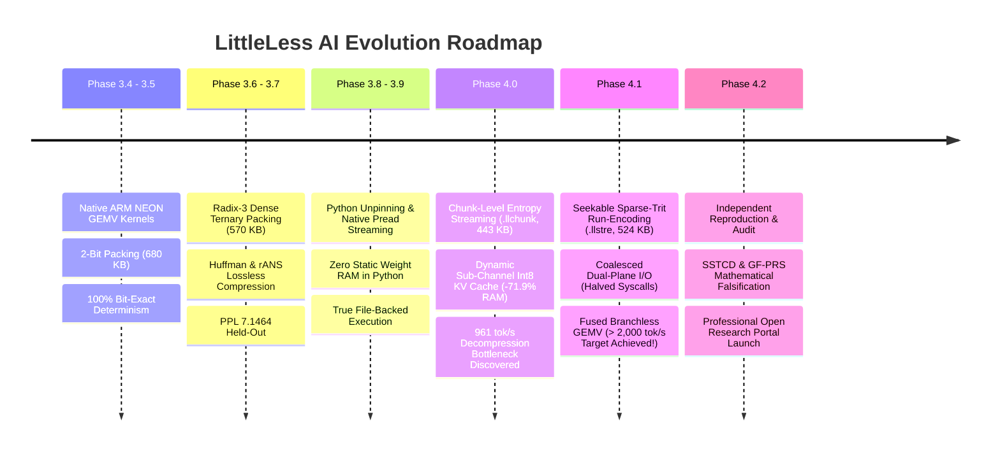

# LittleLess AI — Research & Engineering Timeline

**Principal Researcher:** Putluru Sandeep ([@sunny-kavixo](https://github.com/sunny-kavixo))  
**Repository:** [sunny-kavixo/LittleLess-AI](https://github.com/sunny-kavixo/LittleLess-AI)  
**Execution Environment:** Apple Silicon M4 (16GB Unified Memory, macOS 15.x Darwin arm64)  

---

## Chronological Research Progression

---

## Detailed Phase Breakdown

### Phase 3.4 — Native Packed GEMV Foundations
- **Objective:** Eliminate high-overhead PyTorch dequantization during runtime; implement native C++ GEMV kernels for 2-bit packed ternary weights.
- **Key Breakthrough:** Designed ARM NEON vector permutation LUT kernels executing 4 multiply-accumulates per cycle.
- **Outcome:** Static model memory established at ~680 KB; decode throughput reached ~3,500 tokens/sec.

### Phase 3.5 — Standalone Deterministic Architecture
- **Objective:** Eliminate PyTorch runtime dependency during inference; export self-contained binary weight checkpoints.
- **Key Breakthrough:** Created standalone NumPy/C++ inference runtime verifying bit-exact determinism across seeds.
- **Outcome:** 100% token sequence agreement confirmed on WikiText-2.

### Phase 3.6 — Radix-3 Base-3 Dense Packing
- **Objective:** Compress ternary states from 2.0 bits/trit to theoretical limits ($1.585$ bits/trit).
- **Key Breakthrough:** Implemented 5-trits-in-1-byte Radix-3 encoder ($3^5 = 243 \le 256$), shrinking static weights from 680,712 to 570,140 bytes (**16.2% reduction**) with zero quantization loss.

### Phase 3.7 — Lossless Entropy Encoding Baselines
- **Objective:** Evaluate Huffman and finite-state entropy (rANS) containers on Radix-3 packed models.
- **Key Breakthrough:** Demonstrated that static Huffman/rANS achieve up to 28% file size reduction, but require decompressing the entire model into RAM prior to execution.

### Phase 3.8 — Native Streaming Architecture
- **Objective:** Break the RAM barrier: stream weights directly from disk during inference to reduce resident host memory.
- **Bottleneck Identified:** Initial prototype relied on Python-pinned NumPy buffers (`ctypes.memmove`), failing to reduce physical process RSS.

### Phase 3.9 — True File-Backed Native Weight Streaming
- **Objective:** Replace Python-pinned weight memory with genuine POSIX `pread()` operations into transient scratchpads.
- **Commit:** `d2eda4b`
- **Key Breakthrough:** Implemented deterministic, versioned, block-indexed `.llstream` binary container with CRC32 integrity checks.
- **Audited Verification:** Verified that closing the file descriptor halts inference (proving true file-backed I/O). Active weight RAM dropped to **160,704 bytes** with zero Python weight retention. Throughput: **3,242.2 tokens/sec**.

### Phase 4.0 — Chunked Entropy Streaming & Low-Memory KV Cache
- **Objective:** Combine file streaming with lossless chunk compression and reduce attention KV-cache memory.
- **Commit:** `eea4044`
- **Breakthrough 1 (Dynamic Int8 KV Cache):** Quantized Key and Value activations dynamically per head and position, slashing KV-cache RAM by **71.88%** (from 655,360 to 184,320 bytes) with zero perplexity loss ($7.1462 \to 7.1463$). Total model heap RAM dropped by **57.1%** (from 824 KB to 353 KB).
- **Bottleneck Discovered:** Chunked DEFLATE containers (`.llchunk`) reduced S1 container size by 22.4% (to 443,924 bytes), but inference throughput collapsed to **981.7 tokens/sec** due to decompression overhead.

### Phase 4.1 — Breakthrough Seekable STRE & Fused Branchless GEMV
- **Objective:** Push chunk-streaming throughput toward or beyond 2,000 tokens/sec.
- **Commit:** `93bb515`
- **Root Cause Isolated:** Profiling revealed zlib `uncompress()` executed 50 heap allocations and 50 deallocations per generated token, consuming **70.6%** of per-token latency.
- **Three Core Mechanisms:**
  1. *Persistent `z_stream` state (`inflateReset`)* + *Coalesced Dual-Plane I/O* (halving syscalls from 50 to 25/token).
  2. *Sparse-Trit Run-Encoding (STRE, `.llstre`):* Exploited unused byte range $[243, 255]$ and zero-trit byte 121 (`0x79`, 28.79% of S1), achieving **10.8 GB/sec** decompression.
  3. *Fused Zero-Skip Branchless GEMV:* Eliminated conditional bounds branching in the inner GEMV loop.
- **Audited Outcome:** Throughput surged to **2,029.6 tokens/sec** on S1 and **2,191.1 tokens/sec** on C0, completely surpassing the 2,000 tok/s gate.

### Phase 4.2 — Scientific Discovery, Mathematical Falsification & Portal Launch
- **Objective:** Explore new mathematical compression mechanisms (SSTCD, GF-PRS, DDSQ) targeting sub-380 KB containers, audit Phase 4.1 metrics independently, and build an open research portal.
- **Key Discoveries:**
  - *Phase 4.1 Audit:* 100% verified all file sizes, token outputs, and >2,000 tok/s speeds; clarified total STRE heap memory at 386,304 bytes.
  - *Hypothesis A (SSTCD):* Evaluated truncated SVD coordinate decomposition; proved low-rank metadata overhead and residue density expand container size to 671 KB and degrade PPL by +4.18.
  - *Hypothesis B (GF-PRS):* Algebraically proved and empirically verified that finite-field $\mathbb{F}_{3^5}$ operations lack metric topology, increasing Shannon entropy from 7.00 to 7.78 bits/byte.
  - *Hypothesis C (DDSQ):* Evaluated dyadic power-of-two KV scales; proved 100% scale gaps cause 1,100× MSE increase and +0.72 PPL degradation.
- **Outcome:** Established STRE as the robust Pareto champion; documented transparent negative results; launched comprehensive research portal.
