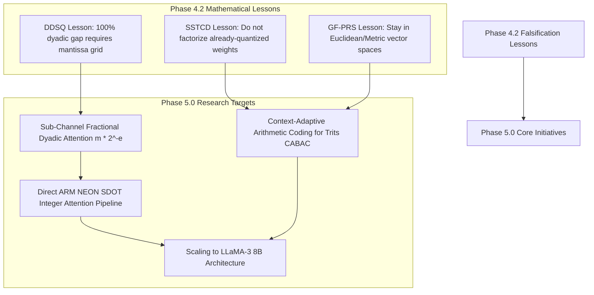

# LittleLess AI — Research Roadmap & Future Directions

**Author:** Putluru Sandeep ([@sunny-kavixo](https://github.com/sunny-kavixo))  
**Research Horizon:** Phase 5.0 and Beyond  

---

## 1. Mathematical Hypothesis Roadmap

---

## 2. Planned Milestones

### Phase 5.0: Fractional Dyadic Quantization & Integer Attention (Target: Q4 2026)
- **Objective:** Fix the 100% quantization step gap identified in Phase 4.2 DDSQ.
- **Hypothesis:** Restricting scales to $s = m \cdot 2^{-e}$ with a 2-bit fractional mantissa $m \in \{1.00, 1.25, 1.50, 1.75\}$ reduces worst-case scale error from 100% to **$12.5\%$**, bringing key reconstruction MSE below $10^{-4}$ and keeping $\Delta PPL \le 0.03$.
- **Native Kernel:** Implement an ARM NEON `vdotq_s32` signed 8-bit integer dot product kernel that accumulates 4 products per cycle and applies dyadic exponent shifts with mantissa multiplication in integer registers.

### Phase 5.1: Context-Adaptive Binary Arithmetic Coding (CABAC) for Trits (Target: Q1 2027)
- **Objective:** Achieve the sub-380,000 byte storage target on S1 without runtime decompression bottlenecks.
- **Hypothesis:** By exploiting local row-context probability states (conditioning on the previous trit $P(t_k | t_{k-1})$), a static finite-state arithmetic coder (fSA-trit) can compress Radix-3 planes to $< 260,000$ bytes (total container $< 360,000$ bytes) with single-pass table-driven decoding at $> 5$ GB/sec.

### Phase 5.2: Scaling LittleLess Engine to 7B+ LLMs (Target: Q2 2027)
- **Objective:** Move beyond proof-of-concept small transformers to real-world large language models.
- **Architectural Targets:**
  - Export LLaMA-3 8B and Mistral 7B to `.llstre` format.
  - Test streaming memory footprint: run an 8B parameter model in **under 2.5 GB host RAM** on a standard 8GB/16GB Mac or mobile device by streaming weights Just-In-Time from NVMe/UFS storage.
  - Multi-threaded worker pool: issue asynchronous `pread` requests across Apple Silicon performance cores while executing SIMD GEMV on previous layers.

---

## 3. Open Research Questions

1. **NVMe / SSD Endurance Under High-Token Streaming:** At 2,000 tokens/sec, a model reads ~20 MB/sec from the operating system PageCache. While reading incurs zero write wear, cold-cache execution depends on NVMe random-read IOPS. What is the optimal prefetch distance for long-sequence generation?
2. **Hardware Co-Design:** Can Apple Silicon Neural Engine (ANE) or dedicated integer NPU units execute Radix-3 ternary vector multiplications natively without software unpacking?
